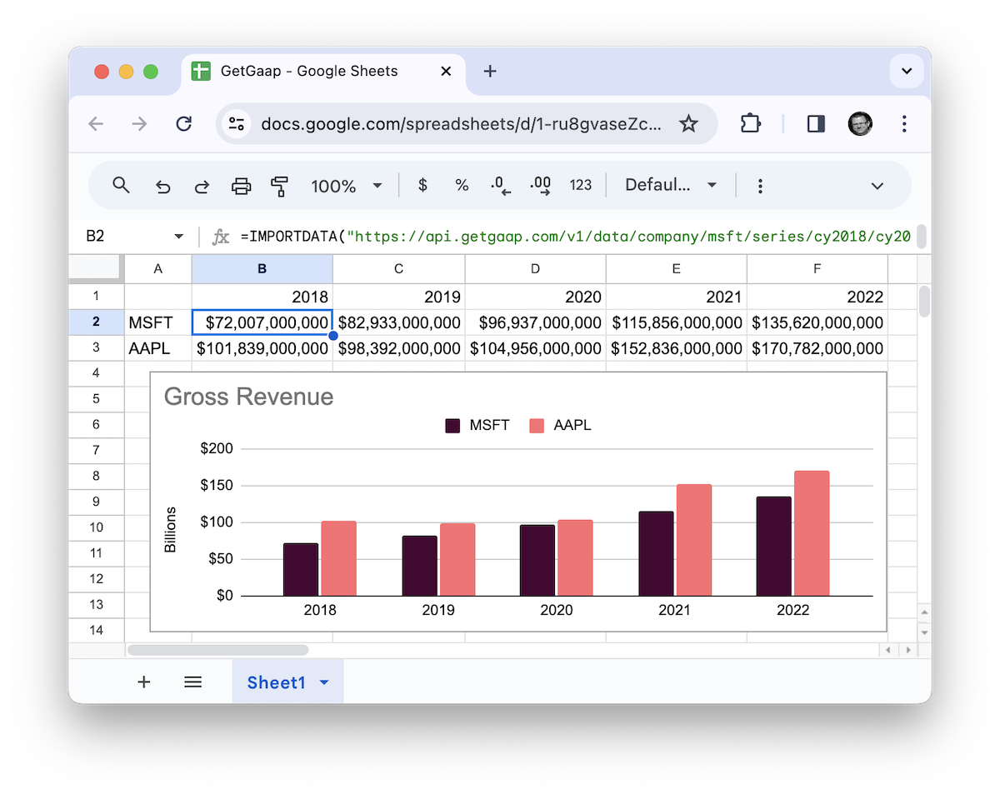
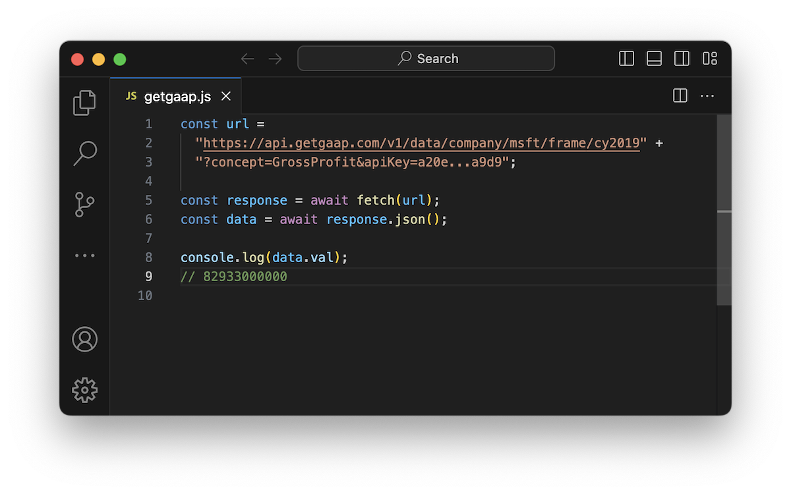

Today, I am launching [GetGaap](https://getgaap.com), a financial API for your app or spreadsheet. Using GetGaap, you can access data from the financial reports companies file with the Securities and Exchange Commission (SEC) in the US.

GetGaap provides access to 100+ million financial facts from 18+ thousand companies filed using forms 10-K, 10-Q, and others, directly from the SEC EDGAR system. You can access quarterly or annual point-in-time data, or a quarterly or annual histogram for a specific metric.

As an investor or financial researcher, you can import the data directly into a spreadsheet to build financial models, custom indices, or charts.

As a developer, you can access the financial data using convenient HTTP APIs serving JSON or CSV. For advanced use cases, GetGaap also supports SQL access.

The best way to get familiar with the platform is to [run through the three-minute tutorial](https://getgaap.com/docs/tutorial) to build your first financial chart in Google Sheets.

### How does GetGaap work?

The [Securities and Exchange Commission](https://www.sec.gov/) (SEC) operates the [SEC EDGAR](https://www.sec.gov/edgar/search-and-access) system that allows companies to file their 10-K, 10-Q, and other financial statements. SEC is then required by law to make this information available to the general public. It does so by exposing a web interface as well as a set of rudimentary APIs. The APIs satisfy the requirement for public disclosure but are not intended for consumption at scale.

This is where [GetGaap](https://getgaap.com) comes in. It provides an API layer on top of the data exposed by SEC EDGAR that is more suitable for direct consumption from apps and spreadsheets.

This is how GetGaap functions at the high level:

1. Every night, it imports all financial statements ever filed in SEC EDGAR as one large ZIP file containing [xBRL](https://www.xbrl.org/) data. This contains 100+ million financial facts from 18+ thousand companies and represents the then-current source of truth.
1. The large ZIP file is uploaded to AWS S3.
1. Processing of the ZIP file is sharded into 40 chunks, each executed in parallel in AWS Lambda.
1. Each shard unzips the relevant portion of the ZIP file, parses the data, and uploads it to Google BigQuery.
1. After all the shards have completed processing, certain static aggregates are calculated and stored in AWS S3, and the snapshot of all the data is "committed" as current.

From there, the [HTTP API](https://getgaap.com/docs) exposed by GetGaap runs queries in BigQuery in response to data requests.

While this may sound like a system with a lot of moving parts, its implementation was hugely accelerated by building GetGaap on top of [47chapters/letsgo](https://github.com/47chapters/letsgo), an OSS boilerplate architecture for AWS. It comes ready with application components like API, Website, workers, and queues, to cut months of development time.

Enjoy!
