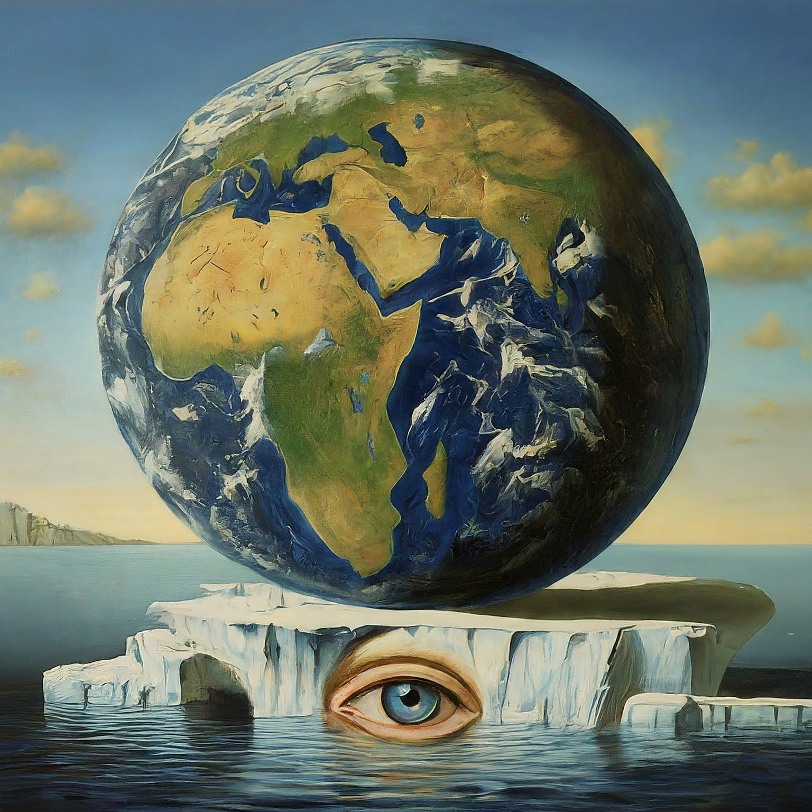

Lately I’ve been exploring the climate space with an eye toward areas where technology can help companies do their part to protect it. One such area is carbon footprint calculation. As a result, today we are shipping [StopGHG](https://go.stopghg.com/P4l2ZG) - a free, self-service carbon footprint calculator for companies.

Understanding your company’s carbon footprint is indispensable to remain competitive. Many regulatory frameworks, such as the [CSRD directive in the European Union](<(https://finance.ec.europa.eu/capital-markets-union-and-financial-markets/company-reporting-and-auditing/company-reporting/corporate-sustainability-reporting_en)>) or the [SEC Climate Rule in the US](https://www.sec.gov/news/press-release/2024-31), require accurate carbon footprint reporting. Beyond legal requirements, companies worldwide that want to improve their image make their carbon footprint public as part of ESG (Environmental, Social, and Governance) reporting. Frequently, customers and partners ask for your carbon footprint to satisfy their own regulatory obligations.

Calculating your company’s greenhouse gas emissions is complex. [StopGHG](https://go.stopghg.com/P4l2ZG) uses the global standards set by the [Greenhouse Gas Protocol (GHG Protocol)](https://ghgprotocol.org/) and the current emission factors published by the [Intergovernmental Panel for Climate Change (IPCC)](https://www.ipcc.ch/) to provide you with the most accurate results needed for compliance.

StopGHG is dedicated to helping the climate by providing companies like yours with the tools they need to do their part. Our free, easy-to-use, web-based carbon footprint calculator built on the GHG Protocol is a great companion on your sustainability journey.

[Start your carbon footprint calculations today!](https://go.stopghg.com/P4l2ZG)

